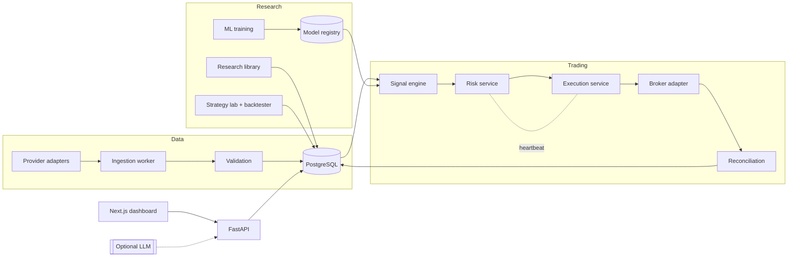

# 01. Software architecture

Status: accepted for Phase 1 (2026-11-19). Owner: APEX core.

## Goals that drive every decision

1. **Capital preservation first.** No path from research or AI code to a broker exists except through the risk service and the execution service. Real-money trading is not available in this release: `TradingMode` has no live value and configuration rejects it (`src/apex/core/config.py`, tested).
2. **Independence from any AI provider.** The trading core is deterministic Python. Local ML (Component B) is optional for any given strategy. External LLMs (Component C) sit behind an interface whose default is "disabled".
3. **Reproducibility.** Every experiment records the exact data version (content hash of the bars), strategy version, code commit, parameters and random seed.
4. **Modularity without premature distribution.** One codebase, one Python package, clearly separated modules with one-way dependencies. It can run as a single process on a laptop or be split into separate processes (API, ingestion worker, research worker, paper-trading engine, risk service) on a server. We do not start with microservices: the cost in operational complexity is not justified for one operator.

## The three components (spec Section 2)

| Component | What it contains | Runs without network AI? |
|---|---|---|
| A. Core trading software | market data, calendars, validation, storage, strategies, backtester, risk, execution, portfolio, reporting, API | Yes, always |
| B. Internal intelligence engine | feature pipelines, scikit-learn / LightGBM / XGBoost models exported to ONNX, regime detection, anomaly detection, strategy ranking | Yes, models are local files |
| C. Optional external AI | Claude, OpenAI, local LLMs (Ollama / llama.cpp) behind `apex.ai.provider.LanguageModel` | Not needed; default provider is `none` |

Dependency rule: **A never imports C. B never imports C. C may read from A and B through public APIs only.** Enforced by review now; an import-linter contract will be added in Phase 2.

## Layered module structure

```
apex.core        config, logging (with secret redaction), clock, errors          (no deps)
apex.domain      instruments, bars, timeframes, cost models                      (core)
apex.db          SQLAlchemy models, sessions, Alembic migrations                 (core, domain)
apex.marketdata  provider interface, providers, calendars, validation, ingestion (core, domain, db)
apex.research    research library, document ingestion, search                    (core, db)
apex.strategies  strategy interface, lifecycle, plugin registry                  (core, domain)
apex.backtest    [Phase 5] event/vectorised backtester, metrics, validation      (strategies, marketdata)
apex.ml          [Phase 7] training, model registry, ONNX inference              (marketdata, strategies)
apex.risk        [Phase 9] independent pre-trade checks, kill switch             (core, domain, db)
apex.execution   [Phase 9/11] order manager, paper broker, broker adapters       (risk, domain)
apex.ai          optional LLM interface                                          (core only)
apex.api         FastAPI read/write API for the dashboard                        (everything above)
apex.cli         operator command line                                          (everything above)
```

## Runtime topology (target, Phase 9+)



Key properties:
- Signals are *intent*. Only the execution service talks to brokers, and it refuses any order not stamped by the risk service within the last N seconds.
- The execution service halts if the risk service heartbeat is missing (spec Section 12: "if the risk service fails, trading must stop").
- On start-up the execution service enters `RECONCILING`, compares broker positions and orders with the database and refuses to trade until they match or an operator resolves the difference (Section 15).

## Phase 1 scope (implemented)

The core package, schema and migrations, the market data layer (three providers, four calendars, validation, idempotent storage, data versioning), a minimal research library, the strategy interface and lifecycle, the optional-AI interface, a read-only API and a CLI. See `docs/STATUS.md` for exactly what exists and what is tested.

## Key decisions and trade-offs

| Decision | Chosen | Alternatives considered | Why |
|---|---|---|---|
| Process model | Modular monolith, splittable into workers | Microservices from day one | One operator; fewer moving parts; can split later along module lines |
| Storage | PostgreSQL, SQLite for single-machine installs and tests | TimescaleDB, ClickHouse, Parquet only | One portable schema. Bars move to partitioned tables or Parquet when volume demands it (see 03) |
| Backtesting | Own engine (Phase 5), vectorbt for fast parameter sweeps | Backtrader only | Backtrader is unmaintained; own engine gives exact control of costs, delays and reproducibility metadata |
| Signal contract | Target position in [-1, 1] per bar | Order-level strategies | Keeps strategies pure and testable for look-ahead; execution concerns stay in the execution layer |
| Time | All timestamps UTC-aware; bar `ts` = open time | Exchange-local time | Avoids DST bugs; calendars convert where needed |
