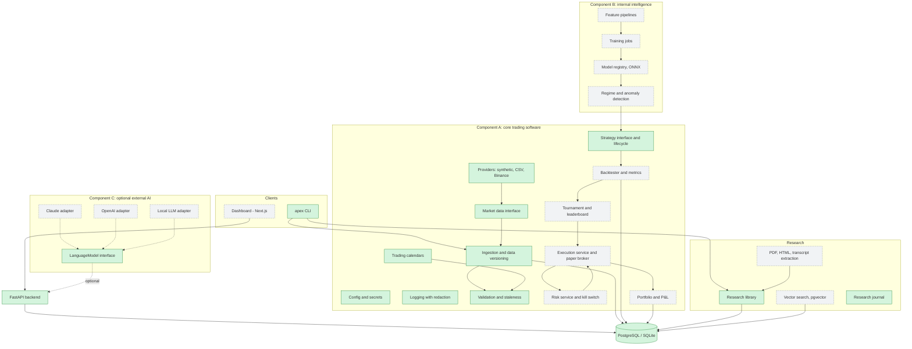

# 02. System component diagram

Green = implemented and tested in Phase 1. Dashed grey = planned.

## Data flow for a backtest (Phase 5 target)

1. Operator or tournament scheduler selects strategy version + params + instrument + range.
2. Backtester loads bars from the database and computes their content hash (`dataset_sha256`).
3. Strategy produces target positions; backtester fills at next bar open with the instrument's `CostModel` plus configured latency.
4. Metrics and the full manifest (data hash, code commit, params, seed) are written to `experiments`.
5. Results appear on the leaderboard; nothing is promoted without passing the validation gates (see 06).
