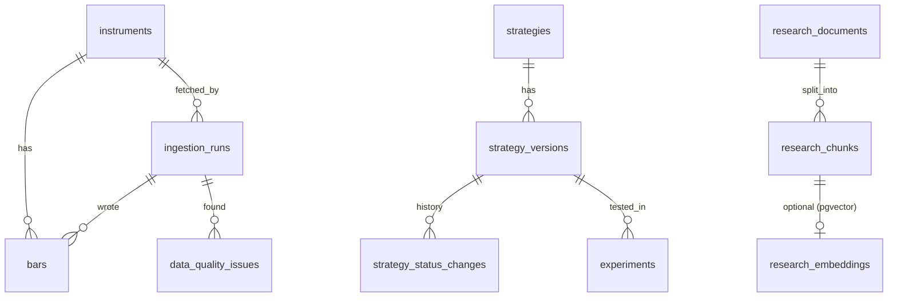

# 03. Database architecture

Implemented in `src/apex/db/models.py`; migrations in `src/apex/migrations/versions/`.
Migrations are tested against both SQLite and PostgreSQL 16 (upgrade and full downgrade).

## Engines

| Use | Engine | Notes |
|---|---|---|
| Server / VPS / Docker | PostgreSQL 16 (+ pgvector) | Recommended for anything long-running |
| Single machine, quick start | SQLite | Same schema; no vector search |
| Tests | Both | `APEX_TEST_POSTGRES_URL` enables the PostgreSQL run |

The schema avoids engine-specific types in the core tables. PostgreSQL-only features arrive in separate, optional migrations that no-op elsewhere (migration `0002` creates `research_embeddings` only when pgvector is installed).

## Entity overview

## Tables (migration 0001)

| Table | Purpose | Key columns |
|---|---|---|
| `instruments` | Instrument master incl. calendar and cost model | unique (`symbol`, `venue`), `asset_class`, `tick_size`, `contract_multiplier`, `cost_model` JSON |
| `bars` | OHLCV bars | PK (`instrument_id`, `timeframe`, `ts`, `source`); `ingestion_run_id` |
| `ingestion_runs` | One fetch from one provider; doubles as the **data version** | `content_sha256`, `status` ok/warn/failed, row counts, error |
| `data_quality_issues` | Every validation finding | `kind` (gap, spike, duplicate, ohlc_inconsistent...), `severity`, `ts` |
| `strategies` | Stable strategy identity | `key` e.g. `TF-SMA-001` |
| `strategy_versions` | Immutable rule versions | `version`, `status`, `spec` JSON, `code_sha256` |
| `strategy_status_changes` | Audit of lifecycle moves | `from_status`, `to_status`, `reason`, `actor` |
| `experiments` | Reproducible runs | `params`, `data_manifest` (instrument, range, hashes), `code_version` (git sha), `random_seed`, `metrics` |
| `research_documents` | Library entries | `sha256` unique (dedupe), `licence_note`, `extracted` JSON |
| `research_chunks` | Retrieval units | (`document_id`, `ordinal`) unique |
| `research_journal` | Permanent research log | `kind` hypothesis/finding/decision/note |
| `audit_log` | Security-relevant actions | `actor`, `action`, `target`, `detail` |

## Design rules

- **Time:** all `DateTime(timezone=True)`; a `UTCDateTime` type guarantees aware UTC values even on SQLite. Naive datetimes are rejected on write.
- **Idempotent ingestion:** bars insert with `ON CONFLICT DO NOTHING`, so re-running an ingest stores nothing new and the content hash is unchanged (tested).
- **Multiple sources:** `source` is part of the bar key, so vendor data can be compared side by side; strategies always name the source they consume.
- **Data versioning:** `content_sha256` is the SHA-256 of the canonical CSV rendering of the bars. `dataset_sha256()` recomputes it for any stored range, and experiments store it in `data_manifest`.
- **Prices as float64.** Adequate for research. Order and fill tables (Phase 9) will use `NUMERIC` because they hold money.
- **Append-only history:** status changes, journal and audit tables are never updated in place.

## Scaling path

Rough sizes: one instrument of 1-minute bars for 10 years is ~2.5M rows for 24/7 crypto. Twenty instruments is ~50M rows, which PostgreSQL handles fine with the composite PK index. Beyond that, in order of preference:
1. Native range partitioning of `bars` by month (migration, no code change).
2. TimescaleDB hypertable if installed (optional migration, like pgvector).
3. Tick data in Parquet files on disk, catalogued in the database, read with pandas/pyarrow or DuckDB.

## Planned tables (later phases)

`orders`, `fills`, `positions`, `accounts`, `risk_limits`, `risk_events`, `kill_switch_events`, `models`, `model_versions`, `users`, `roles`, `workspaces`, `broker_connections` (credentials encrypted, see 13). Multi-tenancy (Section 17) will add a `workspace_id` to user-owned tables; all current tables can take it as a nullable column without rework.
